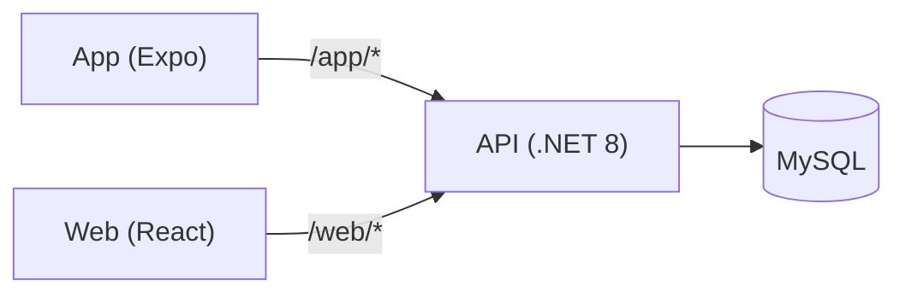

# Family Vault API


**Monolithic .NET 8 API** for managing users, accounts, categories, and transactions. It is the single owner of data and rules of **Family Vault**, serving two clients: the [web panel](https://github.com/Filipe-Saulo/Family-Vault-Web) (React, Administrator only) and the [mobile app](https://github.com/Filipe-Saulo/family-vault-app) (Expo).



## Highlights

- **Per-device sessions**: refresh tokens live in their own table, stored only as SHA-256 hashes and grouped in a family per login, so web, app and several devices coexist and logout ends only the current session
- **Refresh token rotation** with an atomic swap and **reuse detection**: a token replayed after a 10 s grace window revokes only its own session, while concurrent refreshes and lost responses don't log anyone out
- Account **lockout** (5 wrong passwords, 15 min) with a generic 401 that never reveals which accounts exist
- Password recovery by 6-digit **code** sent by SMS or e-mail (also used to confirm sign-up), with wrong guesses counting toward lockout
- Categories are **global or personal**; changing or deleting one in use answers **409**
- Standard error **envelope** (`ApiResponse<T>` with `traceId`), also for 401, 403 and 429
- **Rate limiting** on auth endpoints
- Read-only **MCP server** at `/mcp`: an AI client (Claude Code, MCP Inspector) queries your own finances with a personal token that only works there
- **277 unit tests** on the Service layer and **integration tests** (WebApplicationFactory + in-memory SQLite) through the real HTTP pipeline, run by CI on every push, with **73.1% line coverage**

---

## Features

- ASP.NET Core 8 Web API (monolithic architecture)
- JWT authentication with ASP.NET Core Identity
- Role-based authorization (`Administrator`, `User`) plus permission-claim policies (`ManageCategories`, `ManageTransactions`, `ManageTransactionTypes`, `ManageUsers`)
- Financial dashboard with income/expense totals and a per-category, per-type breakdown
- Entity Framework Core with MySQL (Pomelo)
- AutoMapper for DTO mapping
- Serilog logging (console sink + request logging)
- Swagger / OpenAPI documentation
- Health check for MySQL at `/health`
- Rate limiting on auth endpoints (login, register, password forgot/reset, refresh token)
- Automated test suite (xUnit) covering the Service layer, run on every push via CI
- Multi-platform: web apps and mobile apps

## Architecture

Strict layered architecture: `Controller → Service → Repository → EF Core (MySQL)`. Controllers only translate HTTP ↔ DTOs and delegate; business rules and authorization decisions (role, permission-claim, or resource-ownership checks) live in the Service layer; Repositories only persist/query.

## Requirements

- [.NET 8 SDK](https://dotnet.microsoft.com/en-us/download/dotnet/8.0)
- MySQL 8.x

## Getting Started

1. Clone the repository:

```bash
git clone <repo-url>
cd FamilyVaultApi
```

2. Configure connection string and JWT settings in `appsettings.json`:

```json
"ConnectionStrings": {
  "DefaultConnection": "Server=localhost;Port=3306;Database=FamilyVault;User=root;Password=your_password;"
},
"JwtSettings": {
  "Issuer": "FamilyVaultApi",
  "Audience": "FamilyVaultApiClient",
  "DurationInMinutes": 10
}
```

   The JWT signing key is not versioned. The API refuses to start if `JwtSettings:Key` is missing or has fewer than
   32 bytes. In development, set it with user-secrets; in other environments, use the `JwtSettings__Key` environment variable:

```bash
cd FamilyVaultApi
dotnet user-secrets set "JwtSettings:Key" "<32+ characters>"
```

3. Configure the first Administrator (only needed on an empty database; the account is created at startup when no
   Administrator exists). Use user-secrets, never `appsettings.json`:

```bash
cd FamilyVaultApi
dotnet user-secrets set "AdminSeed:Email" "admin@example.com"
dotnet user-secrets set "AdminSeed:Password" "ChangeMe123"
```

Public sign-up (`POST /api/register`) only creates regular users, by phone or e-mail confirmed with a code; further Administrators are created by an
Administrator through `POST /api/User`.

   Optional: to read uploaded bills with the AI (Claude), set the Anthropic key the same way. Without it the API
   still accepts uploads, but the documents stay `Pending`. The model is `Ai:Model` in `appsettings.json`, chosen by
   the evals in `FamilyVaultApi.Evals` (see its README):

```bash
cd FamilyVaultApi
dotnet user-secrets set "Ai:ApiKey" "<anthropic key>"
```

   Optional: Google sign-in for the app (`POST /api/app/google`) accepts ID tokens whose `aud` is one of the OAuth
   client IDs below (the web client ID, which the native SDK uses as audience, and the iOS one). Without them the
   route answers 503. Env vars elsewhere: `GoogleSignIn__ClientIds__0`, `GoogleSignIn__ClientIds__1`.

```bash
cd FamilyVaultApi
dotnet user-secrets set "GoogleSignIn:ClientIds:0" "<web client id>.apps.googleusercontent.com"
dotnet user-secrets set "GoogleSignIn:ClientIds:1" "<ios client id>.apps.googleusercontent.com"
```

4. Apply database migrations:

```bash
dotnet ef database update
```

5. Run the API:

```bash
dotnet run --project FamilyVaultApi
```

6. Access Swagger UI (Development environment only):

- `http://localhost:5090/swagger`
- `https://localhost:7072/swagger`

## Endpoints

### Account

| Method | Endpoint | Description |
|---|---|---|
| POST | `/api/register/code` | Anonymous; body `{phoneNumber}` or `{email}` (exactly one, else 400); always answers 202 and sends a 6-digit code (valid 10 min) only if the destination has no account |
| POST | `/api/register` | Public sign-up of a regular User; body has `code` plus `phoneNumber` or `email` (exactly one) and the profile fields; the destination becomes the login and is confirmed; bad code -> 400; 201 on success |
| POST | `/api/web/login` | Authenticate; refresh token set as an HttpOnly, `SameSite=Lax`, `Path=/api` cookie (the web panel calls the API through its own origin via a proxy) |
| POST | `/api/app/login` | Authenticate; refresh token returned in the response body |
| POST | `/api/app/google` | Anonymous, app only; body `{idToken}` (Google ID token from the native SDK). Creates a User without password or links the account with the same verified e-mail; Administrators get 403; invalid token 401; not configured 503. Same response as `/api/app/login` |
| POST | `/api/logout` | Anonymous; ends only the session of the given refresh token (body `{refreshToken}` or the web cookie) and clears the cookie; always 200, even with a missing or unknown token |
| POST | `/api/web/refreshtoken` | Refresh access token; reads/writes the refresh token via cookie |
| POST | `/api/app/refreshtoken` | Refresh access token; reads/writes the refresh token via request/response body |
| POST | `/api/password/forgot` | Anonymous; body `{phone}` or `{email}` (exactly one, else 400); always answers 202 (never reveals whether the account exists) and sends a 6-digit code by SMS or e-mail |
| POST | `/api/password/reset` | Anonymous; body `{phone}` or `{email}`, plus `code, password, passwordConfirm`; invalid/expired code or locked account -> 400; a wrong code counts as a failed attempt; unlocks the account and revokes its sessions |
| POST | `/api/password/change` | Administrator, User; body `{currentPassword, password, passwordConfirm}`; revokes the sessions (log in again) |

> Codes go out by Twilio (SMS) and Resend (e-mail) outside Development/Testing; the API refuses to start without `Sms__Twilio__AccountSid`, `Sms__Twilio__AuthToken`, `Sms__Twilio__From`, `Email__Resend__ApiKey` and `Email__Resend__From`. In Development/Testing `LoggingVerificationCodeSender` is used instead and writes the code to the log (`Código de verificação (PasswordReset, Sms) para ***1234: 123456`) **only in Development**; elsewhere it logs just that a code was generated. Send limit per phone/e-mail: `VerificationCode:SendLimit` (1/min, 5/day).

### Category

| Method | Endpoint | Roles |
|---|---|---|
| POST | `/api/category` | Administrator (creates a global category), User (creates a personal one) |
| GET | `/api/category` | Administrator (global categories), User (global + own) |
| GET | `/api/category/lookup` | Administrator, User — every category, unpaginated, ordered by description (for selects) |
| PUT | `/api/category/{id}` | Global: Administrator or `ManageCategories`; personal: its owner too. 409 when changing the purpose of a category in use |
| DELETE | `/api/category/{id}` | Same as PUT; 409 when the category has transactions |

### Transaction

| Method | Endpoint | Roles |
|---|---|---|
| POST | `/api/transaction` | Administrator, User |
| GET | `/api/transaction` | Administrator, User — a `User` without `ManageTransactions` only sees their own; filters `description`, `startDate`/`endDate` (`YYYY-MM-DD`, end date inclusive), category, type, amount range |
| PUT | `/api/transaction/{id}` | Administrator, `ManageTransactions`, or the owner |
| DELETE | `/api/transaction/{id}` | Administrator, `ManageTransactions`, or the owner |

### Charge (bills by upload)

| Method | Endpoint | Roles |
|---|---|---|
| POST | `/api/charge/upload` | Administrator, User — multipart `file` (PDF, JPEG or PNG, up to 10 MB); answers 202 `{documentId}`, 429 over the daily limit; the same file sent twice returns the existing `documentId` (if that document failed, it goes back to the queue) |
| GET | `/api/charge` | Administrator, User — only the caller's own charges; filter `status` (`PendingReview`, `Confirmed`, `Dismissed`) |
| GET | `/api/charge/{id}` | Administrator, User — owner only (404 missing, 403 other user's) |
| GET | `/api/charge/failures` | Administrator, User — the caller's documents that failed, with the visible reason |
| POST | `/api/charge/{id}/confirm` | Administrator, User — owner only; `description`, `amount`, `dueDate`, `categoryId`; creates the expense (date = due date), 201 with the transaction, 409 if already decided |
| POST | `/api/charge/{id}/dismiss` | Administrator, User — owner only; optional `{ignoreSender}` (ignored for now), 204, 409 if already decided |

### TransactionType / CategoryPurpose (lookups)

| Method | Endpoint | Roles |
|---|---|---|
| GET | `/api/transactiontype` | Administrator, User |
| POST / PUT | `/api/transactiontype` | `ManageTransactionTypes` permission |
| GET | `/api/categorypurpose` | Administrator, User |
| POST / PUT | `/api/categorypurpose` | `ManageCategories` permission |

### User

| Method | Endpoint | Roles |
|---|---|---|
| GET | `/api/User` | `ManageUsers` permission — `search` matches name, e-mail or phone |
| POST | `/api/User` | Administrator — creates an Administrator (e-mail) or a User (phone), `role` in the body |
| GET | `/api/User/me` | Administrator, User — the caller's own profile |
| PUT | `/api/User/{id}` | Administrator, the user themselves, or `ManageUsers` on a non-Administrator account (403 on an Administrator) |
| DELETE | `/api/User/{id}` | Same as PUT; 409 for the last Administrator |
| POST | `/api/User/{id}/password` | Administrator — sets a new password for the user (body `{password, passwordConfirm}`) and revokes their sessions |
| GET | `/api/User/{userId}/permissions` | Administrator |
| POST | `/api/User/{userId}/permissions` | Administrator — body `{permission}`, the number (`4`) or the name (`"ManageUsers"`) |
| DELETE | `/api/User/{userId}/permissions/{permission}` | Administrator |

### Dashboard

| Method | Endpoint | Roles |
|---|---|---|
| GET | `/api/dashboard/summary` | Administrator, User (scoped to own data for `User`); `startDate`/`endDate` as `YYYY-MM-DD`, current month by default |

### MCP tokens

| Method | Endpoint | Roles |
|---|---|---|
| GET | `/api/user/me/mcp-tokens` | Administrator, User — the caller's tokens that were not revoked (expired ones included, with `isExpired`); never the value |
| POST | `/api/user/me/mcp-tokens` | Administrator, User — `{name, expiresInDays?}` (30, 90 or 365; default 90); 201 with `token` (`fv_pat_...`), shown only this once; 409 above 5 active tokens |
| DELETE | `/api/user/me/mcp-tokens/{id}` | Administrator, User — owner only (404 otherwise), 204 |

### MCP server (`/mcp`)

Streamable HTTP, stateless, authenticated **only** by a personal token (`Authorization: Bearer fv_pat_...`); the JWT is refused there, and the personal token is refused everywhere else. Tools are read-only and always return the token owner's data, even for an Administrator:

| Tool | Arguments |
|---|---|
| `get_financial_summary` | `startDate`, `endDate` (`YYYY-MM-DD`) |
| `search_transactions` | `startDate`, `endDate`, `categoryId?`, `description?`, `page?` (20 per page) |
| `list_categories` | — |
| `list_pending_charges` | — (issuer and description are trimmed: they come from third-party documents) |

60 requests per minute per token (`Mcp:CallsPerMinute`, 429 above it). Each tool call is logged with tool, user, token and duration.

#### Demo

1. Run the API (`dotnet run --project FamilyVaultApi`) and log in (`POST /api/app/login` in Swagger).
2. `POST /api/user/me/mcp-tokens` with `{"name": "Claude Code"}` and copy `data.token`.
3. **Claude Code**: `claude mcp add --transport http family-vault http://localhost:5090/mcp --header "Authorization: Bearer fv_pat_..."`, then ask, e.g., "How much did I spend last month by category?".
4. **MCP Inspector** (alternative): `npx @modelcontextprotocol/inspector`, transport *Streamable HTTP*, URL `http://localhost:5090/mcp`, header `Authorization: Bearer fv_pat_...`, then *List Tools* and run `get_financial_summary`.
5. Revoke with `DELETE /api/user/me/mcp-tokens/{id}`: the next call answers 401.

### Health

| Method | Endpoint | Description |
|---|---|---|
| GET | `/health` | MySQL connectivity check |

## Tests

The `FamilyVaultApi.UnitTests` project (xUnit + Moq + FluentAssertions + Bogus) covers the Service layer — business rules, authorization decisions (ownership vs. permission-based access), and validation, with all dependencies mocked (no database required to run it).

```bash
dotnet test FamilyVaultApi.UnitTests
```

The `FamilyVaultApi.IntegrationTests` project boots the whole API with `WebApplicationFactory` in the `Testing` environment, swapping MySQL for an in-memory SQLite database (schema and seeded roles from `EnsureCreated`), and checks the startup admin seed (`Data/AdminSeeder.cs`) and the main flows over HTTP (`Http/`): login of the seeded admin, the `ApiResponse` envelope with `traceId` on 401/403, granting permissions (an unknown number answers 400), and category and transaction CRUD with the owner rule (a User never sees or changes another User's records). It needs no running database either.

```bash
dotnet test FamilyVaultApi.IntegrationTests
```

### Coverage

**Line coverage: 73.1%** (branch 70.1%), unit and integration tests combined, measured on the `FamilyVaultApi` project without the generated `Migrations/`. CI prints the report in the job summary; the number above is updated by hand from it. To measure locally (needs `dotnet tool install -g dotnet-reportgenerator-globaltool`; delete `coverage/` first so old runs don't mix in):

```bash
rm -rf coverage
dotnet test FamilyVaultApi.UnitTests --collect:"XPlat Code Coverage" --settings coverage.runsettings --results-directory coverage
dotnet test FamilyVaultApi.IntegrationTests --collect:"XPlat Code Coverage" --settings coverage.runsettings --results-directory coverage
reportgenerator -reports:"coverage/**/coverage.cobertura.xml" -targetdir:coverage/report -reporttypes:TextSummary
```

There is no lint step; `dotnet build` is the static check (also run by CI).

## CI/CD

A GitHub Actions workflow ([`.github/workflows/ci.yml`](.github/workflows/ci.yml)) builds the solution, runs the unit and integration tests with coverage collection and writes the coverage summary (ReportGenerator) to the job page on every push/PR to `main`. This is a deliberately minimal, demonstrative pipeline — since this project isn't deployed anywhere, there's no deploy step; it exists to show a basic automated build+test gate, which in a real-world scenario could be extended with deployment, integration tests against a real database, etc.

## Technologies

- .NET 8, C#
- ASP.NET Core Web API
- Entity Framework Core (Pomelo MySQL)
- AutoMapper
- Serilog
- Swagger / OpenAPI
- xUnit, Moq, FluentAssertions, Bogus (testing)
- GitHub Actions (CI)

---

Built by [Filipe Saulo](https://github.com/Filipe-Saulo) as a portfolio project.
