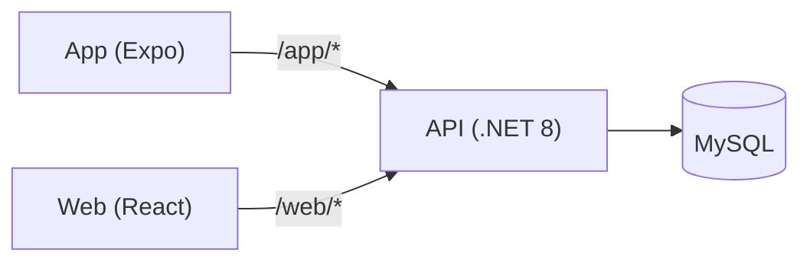

# Family Vault API


**Monolithic .NET 8 API** for managing users, accounts, categories, and transactions. It is the single owner of data and rules of **Family Vault**, serving two clients: the [web panel](https://github.com/Filipe-Saulo/Family-Vault-Web) (React, Administrator only) and the [mobile app](https://github.com/Filipe-Saulo/family-vault-app) (Expo).



## Highlights

- Refresh token **per client** (web cookie / app body), with **reuse detection**: a reused token revokes every session
- Account **lockout** (5 wrong passwords, 15 min) with a generic 401 that never reveals which accounts exist
- Password recovery by 6-digit **code** sent by phone, with wrong guesses counting toward lockout
- Categories are **global or personal**; changing or deleting one in use answers **409**
- Standard error **envelope** (`ApiResponse<T>` with `traceId`), also for 401, 403 and 429
- **Rate limiting** on auth endpoints
- **269 unit tests** on the Service layer, run by CI on every push

---

## Features

- ASP.NET Core 8 Web API (monolithic architecture)
- JWT authentication with ASP.NET Core Identity
- Role-based authorization (`Administrator`, `User`) plus permission-claim policies (`ManageCategories`, `ManageTransactions`, `ManageTransactionTypes`, `ManageUsers`)
- Financial dashboard with income/expense totals and a per-category, per-type breakdown
- Entity Framework Core with MySQL (Pomelo)
- AutoMapper for DTO mapping
- Serilog logging (console sink + request logging)
- Swagger / OpenAPI documentation
- Health check for MySQL at `/health`
- Rate limiting on auth endpoints (login, register, password forgot/reset, refresh token)
- Automated test suite (xUnit) covering the Service layer, run on every push via CI
- Multi-platform: web apps and mobile apps

## Architecture

Strict layered architecture: `Controller → Service → Repository → EF Core (MySQL)`. Controllers only translate HTTP ↔ DTOs and delegate; business rules and authorization decisions (role, permission-claim, or resource-ownership checks) live in the Service layer; Repositories only persist/query.

## Requirements

- [.NET 8 SDK](https://dotnet.microsoft.com/en-us/download/dotnet/8.0)
- MySQL 8.x

## Getting Started

1. Clone the repository:

```bash
git clone <repo-url>
cd FamilyVaultApi
```

2. Configure connection string and JWT settings in `appsettings.json`:

```json
"ConnectionStrings": {
  "DefaultConnection": "Server=localhost;Port=3306;Database=FamilyVault;User=root;Password=your_password;"
},
"JwtSettings": {
  "Issuer": "FamilyVaultApi",
  "Audience": "FamilyVaultApiClient",
  "DurationInMinutes": 10
}
```

   The JWT signing key is not versioned. The API refuses to start if `JwtSettings:Key` is missing or has fewer than
   32 bytes. In development, set it with user-secrets; in other environments, use the `JwtSettings__Key` environment variable:

```bash
cd FamilyVaultApi
dotnet user-secrets set "JwtSettings:Key" "<32+ characters>"
```

3. Configure the first Administrator (only needed on an empty database; the account is created at startup when no
   Administrator exists). Use user-secrets, never `appsettings.json`:

```bash
cd FamilyVaultApi
dotnet user-secrets set "AdminSeed:Email" "admin@example.com"
dotnet user-secrets set "AdminSeed:Password" "ChangeMe123"
```

Public sign-up (`POST /api/register`) only creates regular users by phone; further Administrators are created by an
Administrator through `POST /api/User`.

4. Apply database migrations:

```bash
dotnet ef database update
```

5. Run the API:

```bash
dotnet run --project FamilyVaultApi
```

6. Access Swagger UI (Development environment only):

- `http://localhost:5090/swagger`
- `https://localhost:7072/swagger`

## Endpoints

### Account

| Method | Endpoint | Description |
|---|---|---|
| POST | `/api/register` | Public sign-up of a regular User, by phone only (an e-mail is rejected) |
| POST | `/api/web/login` | Authenticate; refresh token set as an HttpOnly, `SameSite=Lax`, `Path=/api` cookie (the web panel calls the API through its own origin via a proxy) |
| POST | `/api/app/login` | Authenticate; refresh token returned in the response body |
| POST | `/api/logout` | Revoke the user's refresh tokens on both clients (web and app) and clear the cookie; body `{token}` (access token, may be expired) when not authenticated |
| POST | `/api/web/refreshtoken` | Refresh access token; reads/writes the refresh token via cookie |
| POST | `/api/app/refreshtoken` | Refresh access token; reads/writes the refresh token via request/response body |
| POST | `/api/password/forgot` | Anonymous; body `{phone}`; always answers 202 (never reveals whether the account exists) and sends a 6-digit code by phone |
| POST | `/api/password/reset` | Anonymous; body `{phone, code, password, passwordConfirm}`; invalid/expired code or locked account -> 400; a wrong code counts as a failed attempt; unlocks the account and revokes its sessions |
| POST | `/api/password/change` | Administrator, User; body `{currentPassword, password, passwordConfirm}`; revokes the sessions (log in again) |

> There is no SMS provider yet: `LoggingVerificationCodeSender` writes the recovery code to the log (`Código de recuperação para ***1234: 123456`) **only in Development**; in other environments it logs just that a code was generated.

### Category

| Method | Endpoint | Roles |
|---|---|---|
| POST | `/api/category` | Administrator (creates a global category), User (creates a personal one) |
| GET | `/api/category` | Administrator (global categories), User (global + own) |
| GET | `/api/category/lookup` | Administrator, User — every category, unpaginated, ordered by description (for selects) |
| PUT | `/api/category/{id}` | Global: Administrator or `ManageCategories`; personal: its owner too. 409 when changing the purpose of a category in use |
| DELETE | `/api/category/{id}` | Same as PUT; 409 when the category has transactions |

### Transaction

| Method | Endpoint | Roles |
|---|---|---|
| POST | `/api/transaction` | Administrator, User |
| GET | `/api/transaction` | Administrator, User — a `User` without `ManageTransactions` only sees their own; filters `description`, `startDate`/`endDate` (`YYYY-MM-DD`, end date inclusive), category, type, amount range |
| PUT | `/api/transaction/{id}` | Administrator, `ManageTransactions`, or the owner |
| DELETE | `/api/transaction/{id}` | Administrator, `ManageTransactions`, or the owner |

### TransactionType / CategoryPurpose (lookups)

| Method | Endpoint | Roles |
|---|---|---|
| GET | `/api/transactiontype` | Administrator, User |
| POST / PUT | `/api/transactiontype` | `ManageTransactionTypes` permission |
| GET | `/api/categorypurpose` | Administrator, User |
| POST / PUT | `/api/categorypurpose` | `ManageCategories` permission |

### User

| Method | Endpoint | Roles |
|---|---|---|
| GET | `/api/User` | `ManageUsers` permission — `search` matches name, e-mail or phone |
| POST | `/api/User` | Administrator — creates an Administrator (e-mail) or a User (phone), `role` in the body |
| GET | `/api/User/me` | Administrator, User — the caller's own profile |
| PUT | `/api/User/{id}` | Administrator, the user themselves, or `ManageUsers` on a non-Administrator account (403 on an Administrator) |
| DELETE | `/api/User/{id}` | Same as PUT; 409 for the last Administrator |
| POST | `/api/User/{id}/password` | Administrator — sets a new password for the user (body `{password, passwordConfirm}`) and revokes their sessions |
| GET | `/api/User/{userId}/permissions` | Administrator |
| POST | `/api/User/{userId}/permissions` | Administrator |
| DELETE | `/api/User/{userId}/permissions/{permission}` | Administrator |

### Dashboard

| Method | Endpoint | Roles |
|---|---|---|
| GET | `/api/dashboard/summary` | Administrator, User (scoped to own data for `User`); `startDate`/`endDate` as `YYYY-MM-DD`, current month by default |

### Health

| Method | Endpoint | Description |
|---|---|---|
| GET | `/health` | MySQL connectivity check |

## Tests

The `FamilyVaultApi.UnitTests` project (xUnit + Moq + FluentAssertions + Bogus) covers the Service layer — business rules, authorization decisions (ownership vs. permission-based access), and validation, with all dependencies mocked (no database required to run it).

```bash
dotnet test FamilyVaultApi.UnitTests
```

There is no lint step; `dotnet build` is the static check (also run by CI).

## CI/CD

A GitHub Actions workflow ([`.github/workflows/ci.yml`](.github/workflows/ci.yml)) builds the solution and runs the automated test suite on every push/PR to `main`. This is a deliberately minimal, demonstrative pipeline — since this project isn't deployed anywhere, there's no deploy step; it exists to show a basic automated build+test gate, which in a real-world scenario could be extended with deployment, integration tests against a real database, etc.

## Technologies

- .NET 8, C#
- ASP.NET Core Web API
- Entity Framework Core (Pomelo MySQL)
- AutoMapper
- Serilog
- Swagger / OpenAPI
- xUnit, Moq, FluentAssertions, Bogus (testing)
- GitHub Actions (CI)

---

Built by [Filipe Saulo](https://github.com/Filipe-Saulo) as a portfolio project.
